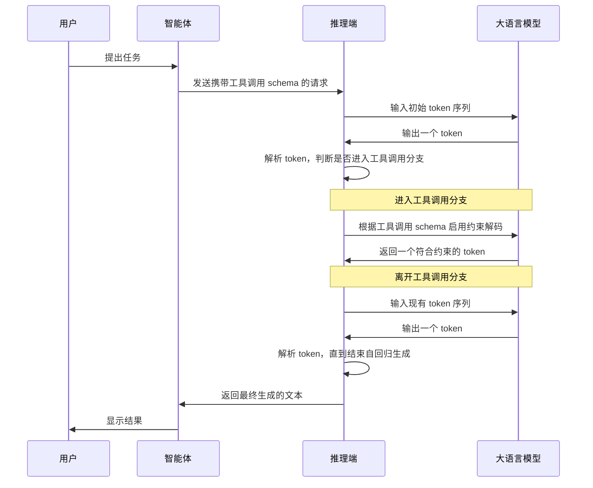
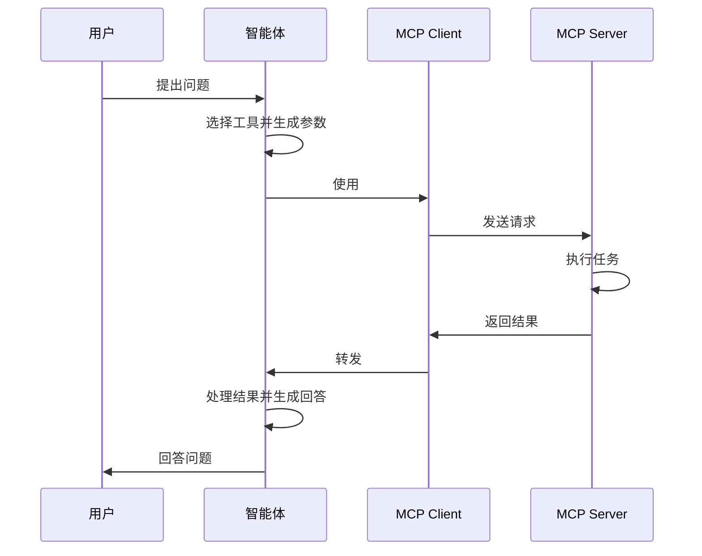

## 基本概念

大语言模型是时下最新潮的概念，指拥有大量参数的、能够根据给定的文本序列生成新文本的模型。

本文介绍一些和大语言模型相关的概念与工具

## 主要技术

### 语言模型

语言模型分为训练阶段和推理阶段。训练阶段根据训练数据产生模型权重，推理阶段根据模型权重把输入文本转为输出文本。

本文不介绍模型的训练，仅简要说明如何模型如何推理。

#### 神经网络

现代语言模型通常都采用神经网络架构。

神经网络中的每个节点被称为神经元。神经元是分层的，前一层的神经元可以连接到后一层的神经元。

神经元之间的连接存在强弱，这可以表示为一个数。对于全连接神经网络，前一层的每个神经元都连接到后一层的每个神经元，因此层与层之间的连接权重可以表示为一个矩阵，称为权重矩阵。并且，每个神经元都可以有一个默认值。一层中每个神经元的默认值组成一个向量，称为偏置向量。

前向传播就是根据前一层的神经元的值计算后一层神经元的值，这包含线性的部分和非线性的部分

- 线性的部分可以表示为向量和矩阵相乘以及向量之间的加法。向量由前一层中每个神经元的值组成，矩阵是层与层之间的权重矩阵。将 $l-1$ 层和 $l$ 层之间的权重矩阵记为 $W^{(l)}$，$l$ 层的偏置向量记为 $b^{(l)}$，$l-1$ 层神经元的值记为 $a^{(l-1)}$，$l$ 层激活前的值记为 $z^{(l)}$，那么线性的部分表示为

    $$
    z^{(l)}=W^{(l)}a^{(l-1)}+b^{(l)}
    $$

- 非线性的部分可以表示为激活函数。激活函数是非线性的，并且是可导的——训练时需要激活函数的导数。当然，激活函数允许有可数的奇异点，因为训练时可以人为规定奇异点的导数。常见的激活函数包括 ReLU、Sigmoid、Tanh。将激活函数记为 $\sigma$，$l$ 层神经元的值记为 $a^{(l)}$，那么非线性的部分表示为

    $$
    a^{(l)}=\sigma(z^{(l)})
    $$

结合起来，就得到了根据 $l-1$ 层输出计算 $l$ 层输出的公式

$$
a^{(l)}=\sigma\left(
    W^{(l)}a^{(l-1)}+b^{(l)}
\right)
$$

神经网络的输入是一个向量，该向量直接作为第 $0$ 层的输出 $a^{(0)}$。通过前向传播，得到最后一层的输出 $a^{(n)}$。最后一层的输出就是整个神经网络的输出——因此，神经网络的输出也是一个向量。

在这个意义上，神经网络的前向传播是一个输入向量、输出向量的函数

$$
v_o = F(v_i)
\qquad
F: \mathbb{R}^m \to \mathbb{R}^n
$$

权重矩阵和偏置向量都是在训练时确定的。

#### 分词和词嵌入

语言模型的输入和输出都是文本，但神经网络的输入和输出都是向量。因此需要通过预处理把文本编码成向量。这包含两部分

- 分词。把输入文本切割成 token。
- 词嵌入。把每个 token 映射为一个向量。

于是，一段文本首先被切割为一系列 token，然后每个 token 被映射成一个向量。这样一段文本就变成了一个向量序列。长度为 $t$ 的向量序列可以表示为

$$
x_0, x_1, \cdots, x_{t-1}
$$

#### 递归神经网络

神经网络的前向传播把一个向量映射成一个向量，但一段文本被转换成一个向量序列。因此，我们需要把向量序列变成一个向量，同时尽量利用到向量序列中的每个向量——这可以通过递归神经网络实现。

首先需要一个普通的全连接神经网络，表示为

$$
f:\mathbb R^{2d}\to\mathbb R^d
$$

这个神经网络的输入维度是 $2d$，输出维度是 $d$。其中输入维度的前 $d$ 个维度表示状态，后 $d$ 个维度表示输入。

然后选择一个 $d$ 维向量作为初始状态 $h_{init}$。对于维度都是 $d$ 的向量序列 $x_0, x_1, \cdots, x_{t-1}$，递归地应用前向传播，即把前一次前向传播的输出作为后一次前向传播的状态

$$
\begin{align*}
    h_0 &= f(h_{\mathrm{init}},x_0)\\
    h_1 &= f(h_0,x_1)\\
    h_2 &= f(h_1,x_2)\\
    &\vdots\\
    h_{t-1}&=f(h_{t-2},x_{t-1})
\end{align*}
$$

省略中间的过程，这个递归神经网络被抽象为一个输入向量序列、输出向量的函数

$$
h_{t-1} = R(x_0, x_1, \cdots, x_{t-1})
\qquad
R: \mathbb{R}^d \times \cdots \times \mathbb{R}^d \to \mathbb{R}^d
$$

序列的长度可以是任意正整数。

#### 注意力机制

Transformer 架构不进行递归，而是使用注意力机制——它同样可以利用到向量序列中的每个向量。

对于一个全连接网络 $f: \mathbb R^d\to\mathbb R^d$ 和一个输入序列 $X=(x_0,x_1,\cdots,x_{t-1})$，可以将 $f$ 分别应用于 $X$ 中的每一个向量，从而得到一个序列到序列的函数

$$
F(X)=\bigl(
    f(x_0),f(x_1),\cdots,f(x_{t-1})
\bigr)
$$

但 $F(X)$ 第 $i$ 个位置的向量只依赖 $X$ 第 $i$ 个位置的向量，因此不同位置之间的信息没有联系起来。为了让序列中不同位置的向量相互交换信息，我们需要注意力机制。

先用三个权重矩阵 $W_Q,W_K,W_V$ 对每个位置的 $x_i$ 进行线性变换

$$
\begin{align*}
    q_i=W_Qx_i \\
    k_i=W_Kx_i \\
    v_i=W_Vx_i
\end{align*}
$$

其中

- Q 是 Query，$q_i\in \mathbb{R}^{d_k}$ 表示位置 $i$ 想查询的信息；而 $W_Q\in\mathbb R^{d_k\times d}$
- K 是 Key，$k_i\in \mathbb{R}^{d_k}$ 表示位置 $i$ 提供的信息的键；而 $W_K\in\mathbb R^{d_k\times d}$
- V 是 Value，$v_i\in \mathbb{R}^{d_v}$ 表示位置 $i$ 提供的信息的值；而 $W_V\in \mathbb{R}^{d_v\times d}$

然后对满足 $j\le i$ 的每组 $q_i,k_j$ 计算 $s_{ij}$

$$
s_{ij}=\frac{q_i^Tk_j}{\sqrt {d_k}}
$$

$s_{ij}$ 用于衡量第 $i$ 个位置与第 $j$ 个位置的匹配程度。

接着使用带因果掩码的 Softmax 计算注意力权重 $\alpha_{ij}$

$$
\alpha_{ij}
=\frac{e^{s_{ij}}}{\sum_{m=0}^{i}e^{s_{im}}}
$$

这里求和项只从 $0$ 到 $i$，因为位置 $i$ 只被允许关注自身的位置和前面的位置，即 $0,1,\cdots,i$ 这些位置。

最后用注意力权重对 $v_j$ 加权求和，并对输出进行投影，得到 $d$ 维向量

$$
a_i=W_O\left(
    \sum_{j=0}^{i}
    \alpha_{ij}v_j
\right)
$$

这样就定义了自注意力算子

$$
A(X)=(a_0,a_1,\cdots,a_{t-1})
$$

这也是一个从序列到序列的函数

$$
A: (\mathbb R^d)^t\to(\mathbb R^d)^t
$$

Transformer 的一个 Block 是全连接神经网络和自注意力算子的组合

$$
B = (I + F) \circ (I + A)
$$

其中 $I$ 是恒等映射。

完整 Transformer 就是这些 Block 的复合

$$
T=B_L\circ\cdots\circ B_2\circ B_1
$$

只取 $T(X)$ 的最后一个向量，就得到了从向量序列到向量的函数

$$
\operatorname{Last} \circ T
: \mathbb{R}^d \times \cdots \times \mathbb{R}^d \to \mathbb{R}^d
$$

上述计算还省略了很多 Transformer 的细节，比如多头注意力、残差连接、层归一化、位置编码等。不过最终的抽象是一致的——我们得到了一个把向量序列映射到向量的函数，并且最终的结果尽可能地利用到了每一个输入向量。

#### 反分词和反词嵌入

结合分词、词嵌入和 Transformer，现在可以把一段文本映射成一个向量。

输出向量之后可以通过反词嵌入，再解码为一个 token；新的 token 加入到原来的 token 序列中，通过反分词变成一段文本。这样就得到了根据一段文本生成一段新文本的语言模型，只不过一次只能增加一个 token

$$
(y_0, y_1, \cdots, y_{t-1}, y_t) = L(y_0, y_1, \cdots, y_{t-1})
$$

不过，反词嵌入，或者 Unembedding 不是准确的说法——因为完整的反词嵌入包含多个步骤。

设最终得到的向量为 $h_t$，反词嵌入的四个步骤分别是

1. 对 $h_t$ 进行归一化，得到单位向量 $x_t$

    $$
    x_t = \frac{h_t}{\lVert h_t \rVert}
    $$

2. 对 $x_t$ 进行线性投影，得到每个 Token 的 Logits 向量。设词表大小为 $V$，把投影矩阵记为 $W_U\in \mathbb{R}^{V\times d}$，Logits 向量记为 $z_t \in \mathbb{R}^V$，则线性投影可以表示为

    $$
    z_t=W_Ux_t
    $$

3. 对 $z_t$ 通过 Softmax 转为概率分布，得到 $p_t$。记 $z_t$ 的第 $i$ 个分量为 $z_{t,i}$，$p_t$ 的第 $i$ 个分量为 $p_{t,i}$，则 Softmax 表示为

    $$
    p_{t,i}=
    \frac{e^{z_{t,i}}}
    {\sum_{j=1}^{V}e^{z_{t,j}}}
    $$

4. 对 $p_t$ 进行采样。这里存在多种采样策略，比如

    - Greedy Decoding：选择概率最高的 Token
    - Temperature Sampling：先用温度调整分布后再采样
    - Top-k Sampling：只考虑概率最高的 $k$ 个 Token
    - Top-p Sampling：只考虑累计概率达到阈值 $p$ 的 Token


#### 自回归生成

通过分词、词嵌入、Transformer、反词嵌入、反分词，现在可以根据一段文本生成另一段新文本。如前所述，一次只能增加一个新 token

$$
(y_0, y_1, \cdots, y_{t-1}, y_t) = L(y_0, y_1, \cdots, y_{t-1})
$$

我们可以根据新的 token 序列继续生成新 token

$$
(y_0, y_1, \cdots, y_t, y_{t+1}) = L(y_0, y_1, \cdots, y_{t-1}, y_t)
$$

不断重复这一过程，直到生成了一个特殊的、表示序列结束的 token，比如 `<eos>`。

至此，我们的语言模型可以根据一段文本不停地生成新文本。

#### 大语言模型

大语言模型（Large Language Model）的原理就是上述语言模型的原理，只不过其参数非常多。

人们发现当参数足够多后，语言模型会涌现出某种智能，而这就是划分语言模型和大语言模型的界限。

但无论如何，大语言模型至此还只是一个输入文本、输出文本的函数

$$
Y_o = \operatorname{LLM}(Y_i)
$$

为了让 LLM 能够做更多的事情，我们需要改变 LLM 的运行环境。

### 执行器

虽然 LLM 只是一个输入文本、输出文本的函数，但如果把 LLM 输出的文本按照某种格式进行解析，然后让另一个程序根据解析的结果执行对应的动作，那么 LLM 就不再只能思考，而可以做出行动。

这个让 LLM 能够做出行动的程序就叫执行器，或者称为 Harness / Agent。

#### Constrained Decoding

LLM 的输出要被执行器反序列化成 JSON。但 LLM 输出存在不确定性，而 JSON schema 的要求却很严格，一个字符都不能出错。因此，为了让 LLM 能够输出合法的 JSON，我们需要对 LLM 的输出进行约束。

显然我们没办法通过精确修改模型的权重，让 LLM 只输出合法的 JSON。模型的权重非常庞大，根本不可能追踪所有可能的输出路径；我们也没办法通过调整提示词，让 LLM 只输出合法的 JSON。提示词是 LLM 这个函数的输入，而不是对输出的约束。这种方式很不可控。

最终，我们选择在 logits 后、sampling 前对模型进行约束解码

- logits 是所有 token 的概率表。约束解码把非法字符的概率归零，然后重新归一化，得到一个新的概率表
- sampling 是对 token 概率表进行采样。由于新的概率表中只有合法字符拥有非零概率，所以只能采样到合法字符

这种约束解码发生在推理层，模型的权重本身不需要修改。如果使用 LLM provider 提供的 LLM 服务，那么约束解码通常就发生在 provider 的推理服务器上。当请求显式携带了结构化输出的要求时，推理端就会根据给定的 JSON schema 对输出的 token 进行约束解码。最终通过 HTTP 返回的 JSON 就是符合 schema 的 JSON。

不过，实际使用场景会更加复杂。因为 Agent 无法根据用户的问题确定请求中要不要携带 schema，推理端也不能根据 Agent 的请求判断是否启用约束解码——这必须依赖 LLM 的输出。

通常大语言模型在训练时就会确定一些特殊 token 作为标记，比如

- `<tool_call>...</tool_call>` 表示工具调用
- `<think>...</think>` 表示思考

推理端可以实时解析 LLM 的输出，然后判断是否要对下一个 token 启用约束解码。比如推理端可以在看到 LLM 输出 `<tool_call>` 后，对接下来的 token 启用工具调用 schema，在 `</tool_call>` 后再关闭 schema。而 Agent 无法确定 LLM 是否进行工具调用，因此通常每次请求都发送工具调用 schema。

以工具调用为例，一个约束解码的流程示意为



#### Function Calling

现在 LLM 能够输出符合指定 schema 的 JSON。假设 LLM 输出的 JSON 为

```json
{
    "tool": "get_weather",
    "arguments": {
        "city": "Tokyo"
    }
}
```

我们可以让另一个程序去解析这个 JSON，提取其中的 `tool` 和 `arguments` 字段，然后调用真实的 API 去获取数据。最后程序把这个数据反馈给 LLM，由 LLM 总结给用户。

#### ReAct

<!-- TODO ReAct -->

整体上，执行器被设计为 ReAct 架构，即模型先进行思考，然后做出行动；行动得到的结果被反馈给模型，模型由此进一步思考，并进一步行动；这种循环持续到模型不再做出行动为止。

#### MCP

有了 Constrained Decoding 和 Function Calling 后，理论上就已经可以构建 AI Agent 了。

但此时又遇到了软件开发常见的 `m x n` 问题：假设有 `m` 个 Agent 应用和 `n` 个需要接入的数据系统，如果不存在标准协议，那么每个 Agent 要分别接入每个数据系统。这让开发 Agent 的人很累，做数据系统的人也很累。

于是 MCP 诞生了——这只是一个协议，如果 Agent 和数据系统的开发者都遵守协议，那么对接起来就方便很多。

MCP 采用 Client-Server 架构

- Agent 内部实现 MCP Client，待接入的系统实现 MCP Server
- MCP Server 对外暴露数据、工具和操作能力，MCP Client 则与之建立连接并通信

一个 MCP Client 发送的请求大概长这样

```json
{
  "jsonrpc": "2.0",
  "id": 1,
  "method": "tools/call",
  "params": {
    "name": "query_database",
    "arguments": {
      "sql": "SELECT COUNT(*) FROM users"
    }
  }
}
```

MCP Server 执行完请求中的任务后，返回的数据大概长这样

```json
{
  "jsonrpc": "2.0",
  "id": 1,
  "result": {
    "content": [
      {
        "type": "text",
        "text": "用户总数：1250"
      }
    ]
  }
}
```

基于 MCP，用户和智能体应用的交互流程示意为



#### CLI

完整的 MCP 非常繁琐，并且 C-S 架构对于本地开发而言非常笨重。

我们可以通过 Function Calling，让 AI Agent 直接使用命令行工具。假设 LLM 生成的 JSON 为

```json
{
  "name": "execute_command",
  "arguments": {
    "command": "grep -Rn TODO ."
  }
}
```

那么 Agent 解析 JSON 后，直接在本机执行 `grep -Rn TODO .`，然后把结果反馈给 LLM。这就完成了一轮 `ReAct` 循环，简单且高效。

CLI 有非常多的好处

- 命令可以组合。这使得 LLM 可以在一次 Function Calling 中拿到更多信息
- 开发更加高效。Agent 可以直接通过子进程运行指定的命令
- 常用的开发工具通常都会提供命令行入口。这意味着 LLM 一下有了大量可以调用的工具

在过去，资深开发者喜欢 CLI，因为 CLI 入口用起来很方便，适合实现自动化；现在，AI Agent 也喜欢 CLI，仍是因为 CLI 入口用起来很方便，适合本地开发的任务。可以说 CLI 正在逐渐成为人和 AI 共用的入口。

## 工具

### 运行器

LLM 运行器能够运行大语言模型，且会提供可调用的 API

LLM 运行器通常用于本地调试基于 LLM 的应用，或者离线部署 LLM

- [Ollama](Ollama.md) 支持本地运行模型，提供了客户端和服务端

### 智能体

智能体根据应用场景可分为很多种类型，但对开发者而言，最常用的还得是编程智能体。

由于我偏爱 CLI 版本的 Code Agent，因此只重点介绍这种工具。

- [Codex](Codex.md) 由 OpenAI 开发，其 CLI 版本已经开源，且用 Rust 编写
- OpenCode 其 CLI 版本用 TypeScript 编写
- Claude Code 由 Anthropic 开发，暂未开源。根据曾泄露的源码推断，其 CLI 版本用 TypeScript 编写
- Pi 开源的极简 Agent，可以通过插件增加功能
- DeepSeek Harness 比 Pi 更激进，一切皆插件，但官方只提供 Web UI

此外还有各种智能体管理器

- CC Switch 一个 All-in-One 的 AI Agent 管理器，支持 Codex/Claude Code/OpenCode 等主流工具，可以管理 `skills`/`prompts`/`sessions`/`mcp` 各种资源，还可以一键切换 Agent 的配置
