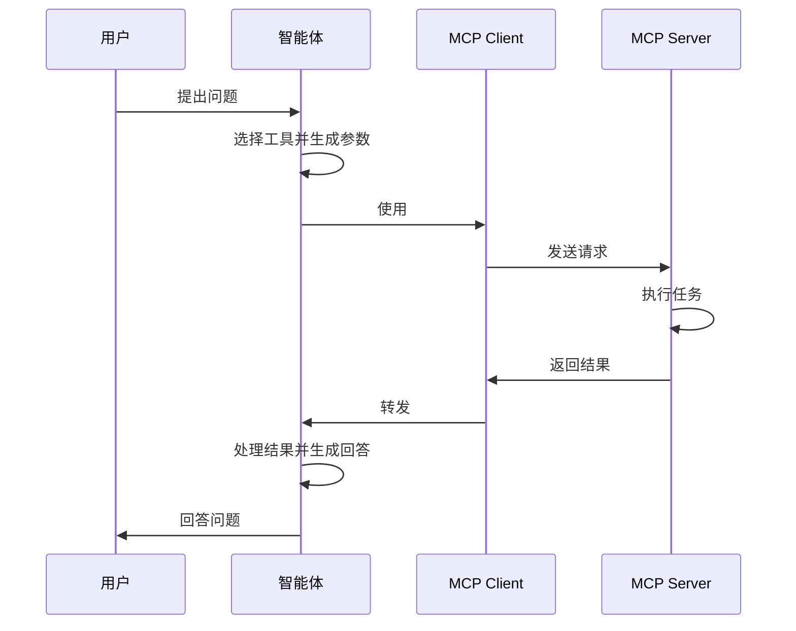

## 基本概念

大语言模型是时下最新潮的概念，指拥有大量参数的、能够根据给定的文本序列生成新文本的模型。

本文介绍一些和大语言模型相关的概念与工具

## 主要技术

### 语言模型

单独一个语言模型的所有功能，就是在给定的文本序列上继续生成文本。这可以表示为一个函数

$$
y_t = L(y_0, y_1, \cdots, y_{t-1})
$$

其中 $y_0, y_1, \cdots, y_{t-1}$ 是已经存在的文本序列，$y_t$ 是生成的下一个文本。

新文本生成后，会加入到已存在的文本序列中，继续用于生成新文本。模型不断重复这一过程，直到生成了一个特殊的、表示序列结束的文本。

当然上述定义过于简略且不准确

- _文本_ 是一种不标准的说法，正确的术语是 **token**，官方翻译为 **词元**
- $L$ 并不是一个完全确定的函数，给定相同的 token 序列，可能会产生不同的下一个 token

大语言模型（Large Language Model）之所以 _大_，就是因为其内部有大量参数。这些参数的具体值会在训练阶段被确定。人们发现当参数足够多后，语言模型会涌现出某种智能，而这就是划分语言模型和大语言模型的界限。

后续的所有应用，比如智能体，都只是基于大语言模型的这个功能构建的。

### 执行器

LLM 只是一个接收文本输出文本的函数，但如果把 LLM 输出的文本按照某种格式进行解析，然后让一个程序去执行解析出来的动作，那么 LLM 就不再只能思考，而可以做出行动。

这个让 LLM 能够做出行动的程序就叫执行器，或者称为 Harness / Agent。

#### ReAct

整体上，执行器被设计为 ReAct 架构，即模型先进行思考，然后做出行动；行动得到的结果被反馈给模型，模型由此进一步思考，并进一步行动；这种循环持续到模型不再做出行动为止。

#### Constrained Decoding

LLM 的输出要被执行器反序列化成 JSON。但 LLM 输出的是 token 概率表，而 JSON schema 的要求却很严格，一个字符都不能出错。因此，为了让 LLM 能够输出合法的 JSON，我们需要对 LLM 的输出进行约束。

显然

- 我们没办法通过精确修改模型的权重，让 LLM 只输出合法的 JSON。模型的权重非常庞大，根本不可能追踪所有可能的输出路径
- 我们也没办法通过调整提示词，让 LLM 只输出合法的 JSON。提示词是 LLM 这个函数的输入，而不是对输出的约束。这种方式很不可控

最终，我们选择在 logits 后、sampling 前对模型进行约束编码

- logits 是所有 token 的概率表。约束编码把非法字符的概率归零，然后重新归一化，得到一个新的概率表
- sampling 是对 token 概率表进行采样。由于新的概率表中只有合法字符拥有非零概率，所以只能采样到合法字符

这种约束编码发生在推理层，模型的权重本身不需要修改。如果使用 LLM provider 提供的 LLM 服务，那么约束解码通常就发生在 provider 的推理服务器上。当请求显式携带了结构化输出的要求时，推理端就会根据给定的 JSON schema 对输出的 token 进行约束编码。最终通过 HTTP 返回的 JSON 就是符合 schema 的 JSON。

#### Function Calling

现在 LLM 能够输出符合指定 schema 的 JSON。假设 LLM 输出的 JSON 为

```json
{
    "tool": "get_weather",
    "arguments": {
        "city": "Tokyo"
    }
}
```

我们可以让另一个程序去解析这个 JSON，提取其中的 `tool` 和 `arguments` 字段，然后调用真实的 API 去获取数据。最后程序把这个数据反馈给 LLM，由 LLM 总结给用户。

#### MCP

有了 Constrained Decoding 和 Function Calling 后，理论上就已经可以构建 AI Agent 了。

但此时又遇到了软件开发常见的 `m x n` 问题：假设有 `m` 个 Agent 应用和 `n` 个需要接入的数据系统，如果不存在标准协议，那么每个 Agent 要分别接入每个数据系统。这让开发 Agent 的人很累，做数据系统的人也很累。

于是 MCP 诞生了——这只是一个协议，如果 Agent 和数据系统的开发者都遵守协议，那么对接起来就方便很多。

MCP 采用 Client-Server 架构

- Agent 内部实现 MCP Client，待接入的系统实现 MCP Server
- MCP Server 对外暴露数据、工具和操作能力，MCP Client 则与之建立连接并通信

一个 MCP Client 发送的请求大概长这样

```json
{
  "jsonrpc": "2.0",
  "id": 1,
  "method": "tools/call",
  "params": {
    "name": "query_database",
    "arguments": {
      "sql": "SELECT COUNT(*) FROM users"
    }
  }
}
```

MCP Server 执行完请求中的任务后，返回的数据大概长这样

```json
{
  "jsonrpc": "2.0",
  "id": 1,
  "result": {
    "content": [
      {
        "type": "text",
        "text": "用户总数：1250"
      }
    ]
  }
}
```

基于 MCP，用户和智能体应用的交互流程示意为



#### CLI

完整的 MCP 非常繁琐，并且 C-S 架构对于本地开发而言非常笨重。

我们可以通过 Function Calling，让 AI Agent 直接使用命令行工具。假设 LLM 生成的 JSON 为

```json
{
  "name": "execute_command",
  "arguments": {
    "command": "grep -Rn TODO ."
  }
}
```

那么 Agent 解析 JSON 后，直接在本机执行 `grep -Rn TODO .`，然后把结果反馈给 LLM。这就完成了一轮 `ReAct` 循环，简单且高效。

CLI 有非常多的好处

- 命令可以组合。这使得 LLM 可以在一次 Function Calling 中拿到更多信息
- 开发更加高效。Agent 可以直接通过子进程运行指定的命令
- 常用的开发工具通常都会提供命令行入口。这意味着 LLM 一下有了大量可以调用的工具

在过去，资深开发者喜欢 CLI，因为 CLI 入口用起来很方便，适合实现自动化；现在，AI Agent 也喜欢 CLI，仍是因为 CLI 入口用起来很方便，适合本地开发的任务。可以说 CLI 正在逐渐成为人和 AI 共用的入口。

## 工具

### 运行器

LLM 运行器能够运行大语言模型，且会提供可调用的 API

LLM 运行器通常用于本地调试基于 LLM 的应用，或者离线部署 LLM

- [Ollama](Ollama.md) 支持本地运行模型，提供了客户端和服务端

### 智能体

智能体根据应用场景可分为很多种类型，但对开发者而言，最常用的还得是编程智能体。

由于我偏爱 CLI 版本的 Code Agent，因此只重点介绍这种工具。

- [Codex](Codex.md) 由 OpenAI 开发，其 CLI 版本已经开源，且用 Rust 编写
- OpenCode 其 CLI 版本用 TypeScript 编写
- Claude Code 由 Anthropic 开发，暂未开源。根据曾泄露的源码推断，其 CLI 版本用 TypeScript 编写
- Pi 开源的极简 Agent，可以通过插件增加功能
- DeepSeek Harness 比 Pi 更激进，一切皆插件，但官方只提供 Web UI

此外还有各种智能体管理器

- CC Switch 一个 All-in-One 的 AI Agent 管理器，支持 Codex/Claude Code/OpenCode 等主流工具，可以管理 `skills`/`prompts`/`sessions`/`mcp` 各种资源，还可以一键切换 Agent 的配置
